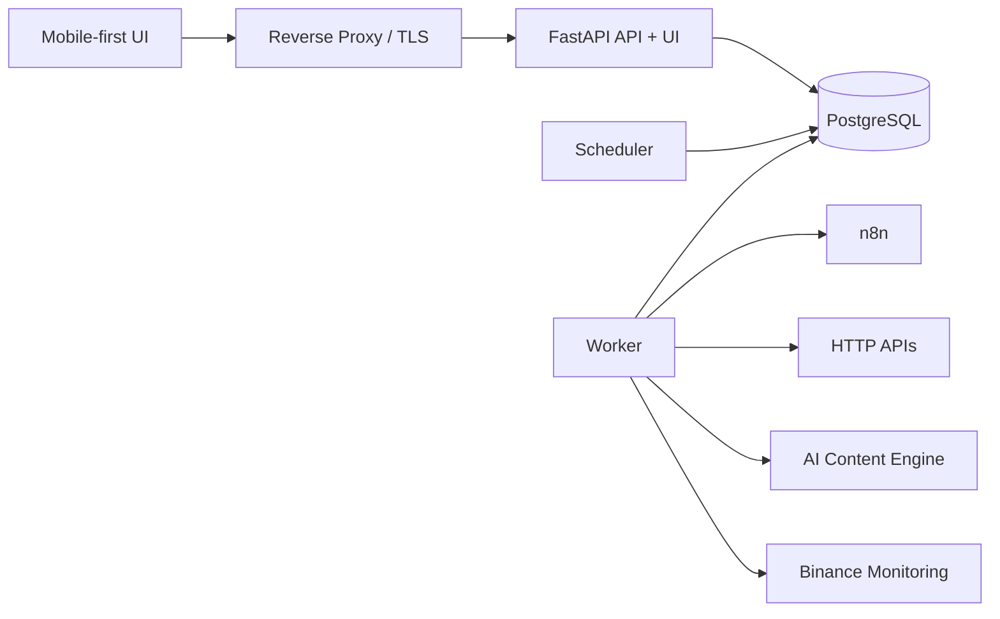

# AI Automation Control Plane

**Self-hosted control plane for reliable AI automation, job orchestration, recovery, and observability.**

AI Automation Control Plane is a self-hosted orchestration and operations layer for heterogeneous automation workloads. It provides durable job state, PostgreSQL-backed scheduling and queues, worker leases, fencing tokens, idempotency, retries, reconciliation, audit trails, health monitoring, and adapter-based integrations for systems such as n8n, HTTP APIs and local Python services.

## Architecture



PostgreSQL is the single authoritative execution state. API and scheduler make control decisions; workers create external side effects through typed adapters. n8n is an execution backend, not the platform source of truth.

## Engineering properties

- **Durable** — jobs, attempts and event timelines live in PostgreSQL.
- **Idempotent** — duplicate requests are keyed and external results are represented by receipts.
- **Recoverable** — worker leases, fencing tokens and a reaper recover crashed executions.
- **Observable** — per-job events, metrics, health and audit are first-class data.
- **Deterministic** — state transitions and retry classification are code, not AI prompts.
- **Adapter-driven** — HTTP, n8n and registered Python operations share a typed contract.
- **Fail-safe** — uncertain external side effects enter reconciliation instead of blind retry.
- **Self-hosted** — Docker Compose deployment with private service networks.

## Job lifecycle

`QUEUED -> RUNNING -> SUCCEEDED`

Additional states: `RETRY_WAIT`, `WAITING_EXTERNAL`, `RECONCILING`, `FAILED`, `DEAD`, `CANCEL_REQUESTED`, `CANCELLED`.

The system intentionally does **not** claim exactly-once execution. The target is **at-least-once delivery + idempotent side effects + durable receipts + reconciliation**.

## Real integrations

The production deployment monitors an AI content automation pipeline and a Binance Futures research/paper engine without moving domain logic into the Control Plane. Content generation remains responsible for provider fallback, rendering, QC and publishing implementation. Binance integration is operational telemetry only; order placement, leverage and strategy decisions are explicitly outside the Control Plane.

## Mobile UI

The UI is server-rendered with FastAPI/Jinja and deliberately avoids a separate Node/React runtime. It includes health, projects, jobs, failures, schedules, workers, job timelines, retry/redrive controls and audit history, with a high-contrast dark layout and large touch targets.

## Quick start

```bash
cp .env.example .env
mkdir -p secrets
printf 'dev-password' > secrets/db_password
printf 'dev-password' > secrets/db_password_app
printf 'dev-session-secret' > secrets/session_secret_app
printf 'change-me' > secrets/owner_password_app
chmod 600 secrets/db_password
sudo chown 10001:10001 secrets/db_password_app secrets/session_secret_app secrets/owner_password_app
chmod 400 secrets/db_password_app secrets/session_secret_app secrets/owner_password_app
docker compose up -d
```

The API container applies the versioned Alembic migrations on startup. Production deployments should use strong randomly generated secrets and may provide environment-specific Compose overrides for private integration networks.

For production, create strong random secrets and never commit `secrets/` or `.env`.

## Tests

```bash
pip install -r requirements.txt
pytest
```

The portfolio goal is not only happy-path coverage. Failure tests are expected for atomic job claims, stale-worker fencing, lease expiry, scheduler deduplication, webhook replay and uncertain external side effects.

## Documentation

- `docs/architecture/system-overview.md`
- `docs/architecture/job-state-machine.md`
- `docs/threat-model.md`
- `docs/adr/`

## Scope

v1 deliberately excludes Kubernetes, Kafka, RabbitMQ, NATS, a generic DAG designer, enterprise multi-tenancy, arbitrary shell execution and autonomous AI state transitions. Those are future options only when measured requirements justify them.
