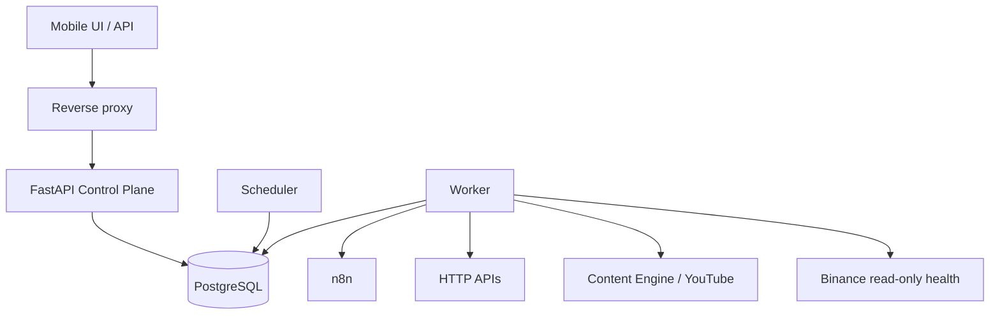

# System overview

The Control Plane is a durable operational layer above heterogeneous execution systems. PostgreSQL is authoritative; API/scheduler make control decisions; workers produce side effects through typed adapters.

## Invariants

1. Accepted jobs are durable in PostgreSQL.
2. A job claim is atomic and leased.
3. Stale workers cannot overwrite a newer lease because of fencing tokens.
4. Side-effecting adapters use idempotency/receipts/reconciliation rather than claiming exactly-once delivery.
5. Control-plane failure must not become trading execution failure.
